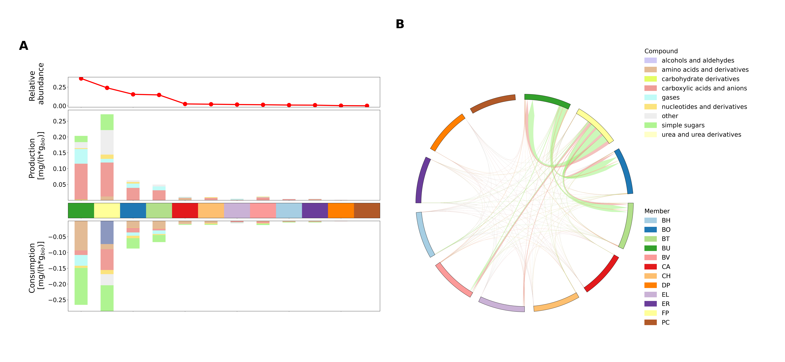

This is the repository for case studies for the SteadierCom tool.

Notebooks show results of analysis with SteadierCom of two case studies: 1. gut microbiome, 2. E. coli mutants.

Publication status: This repository contains code developed for ongoing research at NTNU. The associated manuscript is in preparation. Example figures are illustrative and do not necessarily represent final research results.
